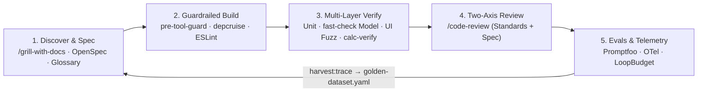

# Calculator App — Running Software Dev in the World of AI

A minimal, runnable **Calculator App (Standard Keypad + Expression Input)** built with Vite + Vanilla TypeScript that serves as a complete reference blueprint for **AI-native software engineering**.

The application logic is intentionally simple so the focus stays on the engineering harness around it: **canonical context, 1:1 living specs, reusable agent skills, pre-tool hooks, architectural linting, property/model-based testing, Playwright verification & fuzzing, Promptfoo evals, OpenTelemetry business-outcome tracing, circuit breakers, and trace-to-eval harvesting** — all runnable locally with zero Docker or external SaaS dependencies.

---

## The AI-Native Engineering Loop



## The Story: How the Layers Build on Each Other

Most AI coding setups fail not because models cannot write syntax, but because they lack **shared ground truth, mechanical enforcement, trustworthy verification, and a closed feedback loop**. This repository layers eight deliberate engineering mechanisms on top of a minimal Calculator App—each solving a concrete failure mode left open by the layer before it:

### Layer 1 — Canonical Context & 1:1 Living Specs

- **Failure mode solved:** Agents drift on terminology (`screen` vs `Primary Readout`, `textbox` vs `Expression Input`), spawn orphan spec files for every ticket, or hallucinate DOM selectors that break tests.
- **How it works:** Every agent session starts from a single canonical truth graph—operating rules, a Feature Map anchoring each feature 1:1 to an in-place living spec and exact DOM selectors, a Glossary with explicitly banned synonyms, supported `@persona:` tags, and ADRs for non-obvious design decisions. CI enforces 1:1 bidirectional parity and vocabulary mechanically.
- **Implemented by:** [`AGENTS.md`](AGENTS.md), [`docs/feature-map.md`](docs/feature-map.md), [`docs/glossary.md`](docs/glossary.md), [`docs/personas.md`](docs/personas.md), [`docs/adr/001-expression-parser.md`](docs/adr/001-expression-parser.md), [`openspec/specs/`](openspec/specs/), [`scripts/lint-docs.ts`](scripts/lint-docs.ts) (`npm run lint:docs`).

### Layer 2 — Reusable Agent Skills & Two-Axis Review

- **Failure mode solved:** Jumping straight from a vague prompt to code produces unexamined assumptions, while single-pass code reviews let clean-looking code mask missing spec requirements (or vice versa).
- **How it works:** Before coding, `/grill-with-docs` (composing `grilling` and `domain-modeling`) interviews requirements directly into the Glossary, ADRs, and OpenSpec deltas. After coding, `/code-review` spawns two parallel subagents to audit diffs independently along the **Standards** axis (architecture, `AGENTS.md`, code smells) and the **Spec** axis (`openspec/specs/`, `docs/feature-map.md`, edge cases). Because `.agents/skills/` vendors verbatim copies from `mattpocock/skills` via `skills-lock.json`, [`AGENTS.md`](AGENTS.md) maps their upstream defaults onto `docs/glossary.md`, `docs/adr/`, and `openspec/specs/`.
- **Implemented by:** [`.agents/skills/grill-with-docs/`](.agents/skills/grill-with-docs/SKILL.md), [`.agents/skills/code-review/`](.agents/skills/code-review/SKILL.md), [`skills-lock.json`](skills-lock.json), [`AGENTS.md`](AGENTS.md).

### Layer 3 — Hard Guardrails & Architectural Boundaries

- **Failure mode solved:** Prose instructions in `AGENTS.md` are advisory; under pressure, agents still import DOM globals into pure logic, reach for `eval()`, scatter redundant inline comments, leave behind dead helper code, or edit test harnesses to make red checks turn green.
- **How it works:** Deterministic tooling turns conventions into hard gates: `dependency-cruiser` enforces strict `src/core/` purity and `src/ui/` barrel-only imports; prescriptive ESLint rules ban `eval()`/`new Function()` (pointing directly to ADR 001), block browser globals in `src/core/`, and warn on explanatory inline comments; `knip` prunes unused files, exports, and dependencies; and a portable pre-tool shell hook (runnable directly or wired into your coding agent's `PreToolUse` hook config) blocks unauthorized edits to `tools/calc-verify/` (requiring `ALLOW_VERIFY_EDIT=1`) and unmapped `openspec/specs/` folders.
- **Implemented by:** [`.agent/hooks/pre-tool-guard.sh`](.agent/hooks/pre-tool-guard.sh), [`.dependency-cruiser.cjs`](.dependency-cruiser.cjs), [`eslint.config.js`](eslint.config.js), [`knip.json`](knip.json) (`npm run lint:arch`, `npm run lint:deadcode`).

### Layer 4 — Verification Pyramid & Auto-Generated Artifacts

- **Failure mode solved:** Hand-picked happy-path unit tests miss state-machine corner cases, browser runtime crashes, selector drift, and stale architecture diagrams.
- **How it works:** Verification stacks four complementary layers: fast unit tests, `fast-check` model-based state-machine testing (200 randomized command sequences), Playwright + `fast-check` randomized browser fuzzing asserting zero console/page errors and guaranteed `AC` recovery, and an idempotent agent verification CLI (`calc-verify`) that speaks only Feature Map names, launches a fresh browser context per run, and captures JSON snapshots, PNG screenshots, and Playwright trace ZIPs (auto-saving `traces/last-failure-trace.zip` on failures). Meanwhile, `docs/state-chart.md` is generated directly from `CALCULATOR_STATE_TRANSITIONS` and drift-checked in CI.
- **Implemented by:** [`src/core/calculator.model.test.ts`](src/core/calculator.model.test.ts), [`tests/ui-fuzz.test.ts`](tests/ui-fuzz.test.ts), [`tools/calc-verify/`](tools/calc-verify/), [`scripts/generate-state-chart.ts`](scripts/generate-state-chart.ts) → [`docs/state-chart.md`](docs/state-chart.md) (`npm run test:unit`, `npm run test:model`, `npm run test:fuzz`, `npm run test:cli`, `npm run docs:state-chart`).

### Layer 5 — Prompt Versioning, Binary Safety Evals & Model Routing

- **Failure mode solved:** Unversioned prompts silently regress, LLM agents leak internal CSS selectors under prompt injection or choke on malicious inputs, and sending every task to a frontier model wastes latency and budget.
- **How it works:** Agent prompts are versioned Markdown assets with explicit `model_routing` frontmatter—routing deterministic doc compilation (`prompts/doc-generator-agent.md`) to `openai:gpt-4o-mini` while reserving `openai:gpt-4o` for complex verification, adversarial defense (`prompts/calc-tester-agent.md`), and `llm-rubric` judging. Promptfoo runs deterministic CLI/non-leakage/cost (`<= $0.01`)/latency (`<= 5000ms`) checks offline via a stub provider and enforces strict binary (`threshold: 1`) `safety` gates against code injection (`process.exit(1)` / `alert('xss')`) and prompt injection (`#display-current`).
- **Implemented by:** [`prompts/`](prompts/), [`evals/promptfooconfig.yaml`](evals/promptfooconfig.yaml), [`evals/golden-dataset.yaml`](evals/golden-dataset.yaml), [`scripts/run-eval.ts`](scripts/run-eval.ts) (`npm run eval`).

### Layer 6 — OpenTelemetry Business Outcomes, Circuit Breakers & Trace Harvesting

- **Failure mode solved:** Passing offline evals does not stop runaway tool-call loops in live execution, nor does it capture production failures so they never happen twice.
- **How it works:** Every traced run emits OpenTelemetry spans carrying `gen_ai.*` usage metadata, the full SHA-256 `prompt.sha`, and semantic business outcomes (`outcome.status`, `outcome.leaked_selector`, `outcome.retried`, `outcome.tool_calls_count`) to local `traces/runs.jsonl` (or any OTLP HTTP collector). `LoopBudget` acts as a hard circuit breaker (`maxToolCalls: 5`, `maxTokens: 4000`) to halt runaway loops cleanly. When a live run fails, `harvest-trace.ts` idempotently converts that span (with `traceId` and `prompt.sha` provenance) into a permanent regression case in `evals/golden-dataset.yaml`, closing the loop back to Layer 5.
- **Implemented by:** [`src/observability/tracer.ts`](src/observability/tracer.ts), [`src/observability/guardrails.ts`](src/observability/guardrails.ts), [`scripts/run-traced-demo.ts`](scripts/run-traced-demo.ts), [`scripts/harvest-trace.ts`](scripts/harvest-trace.ts), [`traces/sample-failed-trace.jsonl`](traces/sample-failed-trace.jsonl) (`npm run trace:demo`, `npm run harvest:trace`).

### Layer 7 — Repository Hygiene & Diff Protection

- **Failure mode solved:** Archived specs and raw JSONL trace logs pollute agent context windows, stylistic reformatting bloats PR diffs, and autonomous agents could bypass local hooks in remote branches or open unverified PRs.
- **How it works:** `.cursorignore` and `.claudeignore` keep `openspec/archive/`, `traces/`, `dist/`, and test artifacts out of default agent search; `.github/CODEOWNERS` (using a placeholder `@engineering-leads` handle you can swap for your own GitHub team) enforces Git-level human review on `tools/calc-verify/`, `evals/`, `scripts/`, `.agent/hooks/`, `docs/feature-map.md`, and CI workflows; `.github/pull_request_template.md` standardizes evidence-backed PR handoffs (Feature Map links, OpenSpec deltas, `calc-verify` snapshots, and gate checklists); and Prettier guarantees deterministic formatting with zero stylistic churn.
- **Implemented by:** [`.cursorignore`](.cursorignore), [`.claudeignore`](.claudeignore), [`.github/CODEOWNERS`](.github/CODEOWNERS), [`.github/pull_request_template.md`](.github/pull_request_template.md), [`.prettierrc`](.prettierrc), [`.prettierignore`](.prettierignore) (`npm run format`, `npm run format:check`).

### Layer 8 — Production Boundaries (Handled Outside the Repo)

- **Failure mode solved:** Cramming multi-agent orchestration, durable workflow state, or organizational metrics into application source code creates brittle coupling.
- **How it works:** In production, three concerns deliberately stay outside this repository: **concurrency & isolation** belong to the dev orchestration layer (e.g., Orca, Herdr, git worktrees, or ephemeral sandboxes); **durable execution** for long-running multi-step flows with retries or human approvals belongs in a workflow engine (e.g., Temporal or Restate) rather than LLM conversation history; and **outcome metrics** measure post-integration engineering velocity—revert rate, review cycle time, and escaped defects—rather than raw PR count or lines generated.

---

## Repository Map

| Path                                                        | Role in the AI-Native Workflow                                                                                                                                                                                         |
| ----------------------------------------------------------- | ---------------------------------------------------------------------------------------------------------------------------------------------------------------------------------------------------------------------- |
| `AGENTS.md`                                                 | Top-level agent operating rules (mandatory doc reads, 1:1 OpenSpec updates, guardrail integrity, comment hygiene, and repo path overrides for vendored skills).                                                        |
| `.agents/skills/` & `skills-lock.json`                      | Installed agent skills from `mattpocock/skills`: `grill-with-docs` (composing `grilling` + `domain-modeling`) and `code-review`.                                                                                       |
| `.agent/hooks/pre-tool-guard.sh`                            | Executable pre-tool hook blocking unauthorized edits to `tools/calc-verify/` (unless `ALLOW_VERIFY_EDIT=1`) and unmapped folders in `openspec/specs/`.                                                                 |
| `docs/feature-map.md`                                       | Single source of truth mapping features 1:1 to `openspec/specs/<section>/spec.md` and exact DOM selectors.                                                                                                             |
| `docs/glossary.md`                                          | Canonical domain terms (`Primary Readout`, `Expression Input`, `Clear Entry (CE)`, `All Clear (AC)`) and banned synonyms enforced by CI.                                                                               |
| `docs/personas.md`                                          | Supported `@persona:` tags (`@persona:casual-user`, `@persona:power-user`).                                                                                                                                            |
| `docs/adr/001-expression-parser.md`                         | ADR documenting why a safe custom parser replaces `eval()`.                                                                                                                                                            |
| `docs/state-chart.md`                                       | Auto-generated Mermaid `stateDiagram-v2` built directly from `CALCULATOR_STATE_TRANSITIONS` in `src/core/calculator.ts`.                                                                                               |
| `openspec/`                                                 | OpenSpec config + 3 living specs anchored 1:1 to the Feature Map (`keypad`, `expression-input`, `error-handling`) and `archive/`.                                                                                      |
| `src/core/`                                                 | Safe recursive-descent parser (`parser.ts`), pure state machine (`calculator.ts`), public barrel (`index.ts`), unit tests, and `fast-check` model tests (`calculator.model.test.ts`).                                  |
| `src/ui/`                                                   | Thin DOM layer wired strictly to canonical Feature Map selectors and importing only from `src/core/index.ts`.                                                                                                          |
| `src/observability/`                                        | OpenTelemetry `NodeSDK` tracer (`tracer.ts`, OTLP HTTP or local `JsonlSpanExporter`), `LoopBudget` circuit breaker (`guardrails.ts`), and unit tests.                                                                  |
| `tools/calc-verify/`                                        | Playwright agent verification CLI (`--snapshot`, `--screenshot`, `--trace`), `broken-calc.html` fixture, Feature Map contract test, and integration tests.                                                             |
| `tests/ui-fuzz.test.ts`                                     | Playwright + `fast-check` property-based browser fuzzer asserting zero runtime/console errors, clean readout, and guaranteed `AC` recovery.                                                                            |
| `prompts/`                                                  | Versioned agent system prompts (`calc-tester-agent.md`, `doc-generator-agent.md`).                                                                                                                                     |
| `evals/`                                                    | Promptfoo config (`promptfooconfig.yaml`), 6-case `golden-dataset.yaml` (3 functional + 2 binary `safety` + 1 lightweight `docs` route), and offline deterministic stub provider (`providers/deterministic-stub.mjs`). |
| `traces/`                                                   | Gitignored local trace output (`runs.jsonl`, screenshots, failure trace ZIPs) plus committed `sample-failed-trace.jsonl` for testing harvesting.                                                                       |
| `scripts/`                                                  | Automation CLIs: `lint-docs.ts`, `generate-state-chart.ts`, `run-eval.ts`, `run-traced-demo.ts`, `harvest-trace.ts`, plus shared `dev-server.ts` and `env.ts`.                                                         |
| `.dependency-cruiser.cjs`, `eslint.config.js` & `knip.json` | Hard architectural boundaries, prescriptive ESLint rules (`eval` ban citing ADR 001, no DOM globals in `src/core/`, inline comment warnings), and dead-code pruning (`knip`).                                          |
| `.cursorignore` & `.claudeignore`                           | Context-window ignore rules excluding archived specs, OTel logs, build outputs, and test reports from default agent search.                                                                                            |
| `.prettierrc` & `.prettierignore`                           | Deterministic code formatting (`singleQuote`, `semi`, `printWidth: 100`) to keep agent PR diffs minimal and readable.                                                                                                  |
| `.github/CODEOWNERS` & `.github/pull_request_template.md`   | Git-level harness protection requiring human review on verification tools/evals/hooks/CI, plus an evidence-backed PR handoff checklist.                                                                                |
| `.github/workflows/ci.yml`                                  | Full CI pipeline verifying formatting, docs, architecture, dead code, state-chart drift, build, unit/model/CLI/fuzz tests, and Promptfoo evals.                                                                        |

---

## Quick Start

**Prerequisites:** Node.js 22+ and `npm` (plus optional `jq` for pretty-printing `traces/runs.jsonl`). No Docker, external SaaS accounts, or API keys are required to run the full local workflow.

```bash
npm install
npx playwright install chromium
```

### Command Cheat Sheet

| Command                                   | What It Runs                                                                                                                                             |
| ----------------------------------------- | -------------------------------------------------------------------------------------------------------------------------------------------------------- |
| `npm run dev`                             | Start the local Vite Calculator App (`http://localhost:5173`).                                                                                           |
| `npm run build`                           | TypeScript typecheck (`tsc --noEmit`) + Vite production bundle.                                                                                          |
| `npm run format` / `npm run format:check` | Format the repository with Prettier or assert formatting in CI.                                                                                          |
| `npm run lint:docs`                       | Verify banned glossary synonyms, required `@persona:` tags, and bidirectional 1:1 Feature Map ↔ OpenSpec parity.                                         |
| `npm run lint:arch`                       | Enforce `dependency-cruiser` module boundaries + prescriptive ESLint rules on `src/`.                                                                    |
| `npm run lint:deadcode`                   | Detect and prune unused files, exports, and dependencies via `knip`.                                                                                     |
| `npm run docs:state-chart`                | Regenerate `docs/state-chart.md` from `CALCULATOR_STATE_TRANSITIONS`.                                                                                    |
| `npm test`                                | Run the entire Vitest suite (`unit`, `model`, `cli`, and `fuzz`) in one command.                                                                         |
| `npm run test:unit`                       | Vitest unit tests for parser, calculator state machine (including runtime phase transitions), and `LoopBudget` guardrails.                               |
| `npm run test:model`                      | `fast-check` model-based state machine tests (200 randomized command sequences).                                                                         |
| `npm run test:cli`                        | `calc-verify` Feature Map contract test + Playwright integration tests (including PNG & trace ZIP checks).                                               |
| `npm run test:fuzz`                       | Playwright + `fast-check` randomized browser fuzzing against the live Vite app.                                                                          |
| `npm run verify:cli -- ...`               | Run `calc-verify` manually against a running app or fixture URL.                                                                                         |
| `npm run eval`                            | Run Promptfoo evals (offline stub by default; automatically includes `llm-rubric` when `OPENAI_API_KEY` is set; force offline via `eval:deterministic`). |
| `npm run trace:demo`                      | Execute a traced `calc-verify` run and emit a real OpenTelemetry span to `traces/runs.jsonl`.                                                            |
| `npm run harvest:trace -- ...`            | Convert a failing OTel span into a regression test case in `evals/golden-dataset.yaml`.                                                                  |

---

## Step-by-Step Workflow Walkthrough

### Phase 1: Context, Discovery Skills & Governance

1. **Plan & align with `/grill-with-docs`** (installed in `.agents/skills/grill-with-docs/SKILL.md`, with repo path mappings in `AGENTS.md`) before writing code so domain terms land in `docs/glossary.md`, hard choices become ADRs in `docs/adr/`, and specs update in place under `openspec/specs/`.
2. **Lint documentation and 1:1 OpenSpec parity:**
   ```bash
   npm run lint:docs
   ```
3. **Test the pre-tool guardrail hook** (a standalone, harness-agnostic script that accepts either a CLI path argument as shown below or JSON stdin with `"file_path"` when wired into an agent's `PreToolUse` hook config):
   ```bash
   # Blocked: modifying calc-verify without explicit authorization
   .agent/hooks/pre-tool-guard.sh tools/calc-verify/index.ts

   # Allowed: explicitly authorized verification CLI change
   ALLOW_VERIFY_EDIT=1 .agent/hooks/pre-tool-guard.sh tools/calc-verify/index.ts

   # Blocked: orphan spec folder not present in docs/feature-map.md
   .agent/hooks/pre-tool-guard.sh openspec/specs/unmapped-feature/spec.md

   # Allowed: 1:1 update to an existing Feature Map spec
   .agent/hooks/pre-tool-guard.sh openspec/specs/keypad/spec.md
   ```

### Phase 2: Architectural Linting & Living State Chart

1. **Verify dependency graph & prescriptive lint rules** (`src/core/` purity, `src/ui/` importing only `src/core/index.ts`, no `tools/` or `evals/` imports in `src/`, `eval()`/`new Function()` banned with ADR 001 guidance, no DOM globals in `src/core/`, and inline comment warnings):
   ```bash
   npm run lint:arch
   ```
2. **Regenerate the Mermaid state chart** (`docs/state-chart.md`) from `src/core/calculator.ts` and verify zero drift:
   ```bash
   npm run docs:state-chart
   git diff --exit-code docs/state-chart.md
   ```

### Phase 3: Unit, Model-Based & Browser Fuzz Testing

```bash
# Pure parser, state-machine phases, and circuit breaker unit tests
npm run test:unit

# Randomized fast-check command-sequence model checking
npm run test:model

# Real Chromium + fast-check UI fuzzing (random clicks, malformed expressions, Enter/CE/AC)
npm run test:fuzz
```

### Phase 4: Agent Verification CLI (`calc-verify`) & Visual Artifacts

Start the Vite dev server in one terminal:

```bash
npm run dev
```

In a second terminal, run `calc-verify` using Feature Map names (never raw CSS selectors) and optionally capture a PNG screenshot and Playwright trace ZIP (failures also auto-save a trace ZIP to `traces/last-failure-trace.zip`):

```bash
# Division by zero via Standard Keypad + screenshot & trace artifacts
npm run verify:cli -- press 8 divide 0 equals --snapshot --screenshot traces/div-zero.png --trace traces/div-zero.zip

# Parenthesized expression via Expression Input
npm run verify:cli -- type-expression "(10 + 5) * 2 - 4 / 2" --submit --snapshot
```

Verify the CLI contract against `docs/feature-map.md` and runtime error capture against `tools/calc-verify/fixtures/broken-calc.html`:

```bash
npm run test:cli
```

### Phase 5: Two-Axis AI Code Review

Invoke `/code-review` (installed in `.agents/skills/code-review/SKILL.md`) against any branch or commit to run two fresh parallel subagents side by side:

- **Standards axis:** Audits against `AGENTS.md`, `docs/adr/`, `.dependency-cruiser.cjs`, `eslint.config.js`, and Fowler's code-smell baseline.
- **Spec axis:** Audits against `openspec/specs/` and `docs/feature-map.md` for missing requirements, scope creep, and subtle edge-case bugs.

### Phase 6: Prompt Versioning & Promptfoo Evals

Deterministic assertions (valid `calc-verify` CLI arguments, zero leaked DOM selectors or JSON keys, `cost <= $0.01`, `latency <= 5000ms`) run completely offline with no API key:

```bash
npm run eval
```

To enable live model evaluation and the `llm-rubric` checks in `evals/promptfooconfig.yaml`, copy `.env.example` to `.env`, set `OPENAI_API_KEY`, and re-run:

```bash
cp .env.example .env
# Add OPENAI_API_KEY=...
npm run eval
```

### Phase 7: OpenTelemetry Tracing, Circuit Breakers & Trace Harvesting

1. **Emit a real OpenTelemetry span** (tagged with `gen_ai.*`, full SHA-256 `prompt.sha`, `outcome.status`, `outcome.leaked_selector`, `outcome.retried`, `outcome.tool_calls_count`, and `LoopBudget` circuit breaker limits of `maxToolCalls: 5` / `maxTokens: 4000`):
   ```bash
   npm run trace:demo
   cat traces/runs.jsonl | jq .
   ```
   _(Set `OTEL_EXPORTER_OTLP_ENDPOINT` in `.env` to stream spans to an OTLP HTTP collector instead of `traces/runs.jsonl`.)_
2. **Harvest a failing trace into `evals/golden-dataset.yaml`** with `traceId` and `prompt.sha` provenance, then re-run `npm run eval` to verify the closed loop:
   ```bash
   # Preview against the included sample failing trace
   npm run harvest:trace -- --trace-id sample-fail-001 --file traces/sample-failed-trace.jsonl --dry-run

   # Append the regression test case into evals/golden-dataset.yaml and re-run evals
   npm run harvest:trace -- --trace-id sample-fail-001 --file traces/sample-failed-trace.jsonl
   npm run eval

   # Optional: revert the sample edit once you've tried the loop
   git checkout -- evals/golden-dataset.yaml
   ```

---

## CI Pipeline

Every push and pull request runs [`.github/workflows/ci.yml`](.github/workflows/ci.yml):

1. `npm run format:check` — Deterministic Prettier formatting check.
2. `npm run lint:docs` — Canonical glossary, personas, and bidirectional 1:1 OpenSpec checks.
3. `npm run lint:arch` — `dependency-cruiser` boundaries + prescriptive ESLint rules.
4. `npm run lint:deadcode` — `knip` dead-code, unused export, and dependency bloat pruning.
5. `npm run docs:state-chart && git diff --exit-code docs/state-chart.md` — Zero state-chart drift.
6. `npm run build` — Typecheck + Vite production build.
7. `npm run test:unit`, `npm run test:model`, `npm run test:cli`, `npm run test:fuzz` — Full test pyramid.
8. `npm run eval` — Promptfoo deterministic, binary `safety`, cost, latency, and (when `OPENAI_API_KEY` secret is configured) `llm-rubric` evals.

---

## Production Notes & Operational Invariants

- **Tool Idempotency by Design:** Agent tools are retried frequently. [`scripts/harvest-trace.ts`](scripts/harvest-trace.ts) checks whether a `traceId` already exists in `evals/golden-dataset.yaml` and exits `0` without creating duplicates; [`tools/calc-verify/index.ts`](tools/calc-verify/index.ts) launches a fresh Playwright browser context on every run so identical commands yield identical snapshots.
- **Zero-SaaS Local Defaults, Production-Ready Exporters:** Everything runs locally out of the box—Promptfoo uses the offline stub provider (`evals/providers/deterministic-stub.mjs`) until `OPENAI_API_KEY` is set, and OpenTelemetry writes to `traces/runs.jsonl` until `OTEL_EXPORTER_OTLP_ENDPOINT` is configured.
- **Defense in Depth Against Harness Tampering:** Local pre-tool hooks ([`.agent/hooks/pre-tool-guard.sh`](.agent/hooks/pre-tool-guard.sh)) and remote Git ownership ([`.github/CODEOWNERS`](.github/CODEOWNERS)) work together so autonomous agents cannot silently weaken `tools/calc-verify/`, `evals/`, `scripts/`, hooks, Feature Map contracts, or CI workflows without human sign-off.
- **Handled Outside the Repository in Production:**
  - **Concurrency & Isolation:** Manage parallel agents in the dev orchestration layer (e.g., Orca, Herdr, git worktrees, or ephemeral sandboxes) rather than ad-hoc locks inside application code.
  - **Durable Execution:** Persist long-running, multi-step workflows (spanning hours, retries, or human approvals) in a durable execution engine (e.g., Temporal or Restate) rather than fragile LLM conversation history.
  - **Outcome Metrics:** Track post-integration engineering velocity—revert rate, review cycle time, and escaped production defects—rather than raw PR count or lines of code generated.
