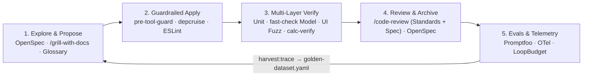

# Calculator App — Running Software Dev in the World of AI

A minimal, runnable **Calculator App (Standard Keypad + Expression Input)** built with Vite + Vanilla TypeScript that serves as a complete reference blueprint for **AI-native software engineering**.

The application logic is intentionally simple so the focus stays on the engineering harness around it: **canonical context, 1:1 living specs, reusable agent skills, pre-tool hooks, architectural linting, property/model-based testing, Playwright verification & fuzzing, Promptfoo evals, OpenTelemetry business-outcome tracing, circuit breakers, and trace-to-eval harvesting** — all runnable locally with zero Docker or external SaaS dependencies.

---

## The AI-Native Engineering Loop



## The Story: How the Layers Build on Each Other

Most AI coding setups fail not because models cannot write syntax, but because they lack **shared ground truth, mechanical enforcement, trustworthy verification, and a closed feedback loop**. This repository layers eight deliberate engineering mechanisms on top of a minimal Calculator App—each solving a concrete failure mode left open by the layer before it:

### Layer 1 — Canonical Context & 1:1 Living Specs

- **Failure mode solved:** Agents drift on terminology (`screen` vs `Primary Readout`, `textbox` vs `Expression Input`), spawn orphan spec files for every ticket, or hallucinate DOM selectors that break tests.
- **How it works:** Every agent session starts from a single canonical truth graph—operating rules, a Feature Map anchoring each feature 1:1 to an in-place living spec and exact DOM selectors, a Glossary with explicitly banned synonyms, supported `@persona:` tags, and ADRs for non-obvious design decisions. CI enforces 1:1 bidirectional parity and vocabulary mechanically.
- **Implemented by:** [`AGENTS.md`](AGENTS.md), [`docs/feature-map.md`](docs/feature-map.md), [`docs/glossary.md`](docs/glossary.md), [`docs/personas.md`](docs/personas.md), [`docs/adr/001-expression-parser.md`](docs/adr/001-expression-parser.md), [`openspec/specs/`](openspec/specs/), [`scripts/lint-docs.ts`](scripts/lint-docs.ts) (`npm run lint:docs`).

### Layer 2 — Reusable Agent Skills & Two-Axis Review

- **Failure mode solved:** Jumping straight from a vague prompt to code produces unexamined assumptions, while single-pass code reviews let clean-looking code mask missing spec requirements (or vice versa).
- **How it works:** Before coding, `/grill-with-docs` (composing `grilling` and `domain-modeling`) interviews requirements directly into the Glossary, ADRs, and OpenSpec deltas. After coding, `/code-review` spawns two parallel subagents to audit diffs independently along the **Standards** axis (architecture, `AGENTS.md`, code smells) and the **Spec** axis (`openspec/specs/`, `docs/feature-map.md`, edge cases). Because `.agents/skills/` vendors verbatim copies from `mattpocock/skills` via `skills-lock.json`, [`AGENTS.md`](AGENTS.md) maps their upstream defaults onto `docs/glossary.md`, `docs/adr/`, and `openspec/specs/`.
- **Implemented by:** [`.agents/skills/grill-with-docs/`](.agents/skills/grill-with-docs/SKILL.md), [`.agents/skills/code-review/`](.agents/skills/code-review/SKILL.md), [`skills-lock.json`](skills-lock.json), [`AGENTS.md`](AGENTS.md).

### Layer 3 — Hard Guardrails & Architectural Boundaries

- **Failure mode solved:** Prose instructions in `AGENTS.md` are advisory; under pressure, agents still import DOM globals into pure logic, reach for `eval()`, scatter redundant inline comments, leave behind dead helper code, or edit test harnesses to make red checks turn green.
- **How it works:** Deterministic tooling turns conventions into hard gates: `dependency-cruiser` enforces strict `src/core/` purity and `src/ui/` barrel-only imports; prescriptive ESLint rules ban `eval()`/`new Function()` (pointing directly to ADR 001), block browser globals in `src/core/`, and warn on explanatory inline comments; `knip` prunes unused files, exports, and dependencies; and a portable pre-tool shell hook (runnable directly or wired into your coding agent's `PreToolUse` hook config) blocks unauthorized edits to `tools/calc-verify/` (requiring `ALLOW_VERIFY_EDIT=1`) and unmapped `openspec/specs/` folders.
- **Implemented by:** [`.agent/hooks/pre-tool-guard.sh`](.agent/hooks/pre-tool-guard.sh), [`.dependency-cruiser.cjs`](.dependency-cruiser.cjs), [`eslint.config.js`](eslint.config.js), [`knip.json`](knip.json) (`npm run lint:arch`, `npm run lint:deadcode`).

### Layer 4 — Verification Pyramid & Auto-Generated Artifacts

- **Failure mode solved:** Hand-picked happy-path unit tests miss state-machine corner cases, browser runtime crashes, selector drift, and stale architecture diagrams.
- **How it works:** Verification stacks four complementary layers: fast unit tests, `fast-check` model-based state-machine testing (200 randomized command sequences), Playwright + `fast-check` randomized browser fuzzing asserting zero console/page errors and guaranteed `AC` recovery, and an idempotent agent verification CLI (`calc-verify`) that speaks only Feature Map names, launches a fresh browser context per run, and captures JSON snapshots, PNG screenshots, and Playwright trace ZIPs (auto-saving `traces/last-failure-trace.zip` on failures). Meanwhile, `docs/state-chart.md` is generated directly from `CALCULATOR_STATE_TRANSITIONS` and drift-checked in CI.
- **Implemented by:** [`src/core/calculator.model.test.ts`](src/core/calculator.model.test.ts), [`tests/ui-fuzz.test.ts`](tests/ui-fuzz.test.ts), [`tools/calc-verify/`](tools/calc-verify/), [`scripts/generate-state-chart.ts`](scripts/generate-state-chart.ts) → [`docs/state-chart.md`](docs/state-chart.md) (`npm run test:unit`, `npm run test:model`, `npm run test:fuzz`, `npm run test:cli`, `npm run docs:state-chart`).

### Layer 5 — Prompt Versioning, Binary Safety Evals & Model Routing

- **Failure mode solved:** Unversioned prompts silently regress, LLM agents leak internal CSS selectors under prompt injection or choke on malicious inputs, and sending every task to a frontier model wastes latency and budget.
- **How it works:** Agent prompts are versioned Markdown assets with explicit `model_routing` frontmatter—routing deterministic doc compilation (`prompts/doc-generator-agent.md`) to `openai:gpt-4o-mini` while reserving `openai:gpt-4o` for complex verification, adversarial defense (`prompts/calc-tester-agent.md`), and `llm-rubric` judging. Promptfoo runs deterministic CLI/non-leakage/cost (`<= $0.01`)/latency (`<= 5000ms`) checks offline via a stub provider and enforces strict binary (`threshold: 1`) `safety` gates against code injection (`process.exit(1)` / `alert('xss')`) and prompt injection (`#display-current`).
- **Implemented by:** [`prompts/`](prompts/), [`evals/promptfooconfig.yaml`](evals/promptfooconfig.yaml), [`evals/golden-dataset.yaml`](evals/golden-dataset.yaml), [`scripts/run-eval.ts`](scripts/run-eval.ts) (`npm run eval`).

### Layer 6 — OpenTelemetry Business Outcomes, Circuit Breakers & Trace Harvesting

- **Failure mode solved:** Passing offline evals does not stop runaway tool-call loops in live execution, nor does it capture production failures so they never happen twice.
- **How it works:** Every traced run emits OpenTelemetry spans carrying `gen_ai.*` usage metadata, the full SHA-256 `prompt.sha`, and semantic business outcomes (`outcome.status`, `outcome.leaked_selector`, `outcome.retried`, `outcome.tool_calls_count`) to local `traces/runs.jsonl` (or any OTLP HTTP collector). `LoopBudget` acts as a hard circuit breaker (`maxToolCalls: 5`, `maxTokens: 4000`) to halt runaway loops cleanly. When a live run fails, `harvest-trace.ts` idempotently converts that span (with `traceId` and `prompt.sha` provenance) into a permanent regression case in `evals/golden-dataset.yaml`, closing the loop back to Layer 5.
- **Implemented by:** [`src/observability/tracer.ts`](src/observability/tracer.ts), [`src/observability/guardrails.ts`](src/observability/guardrails.ts), [`scripts/run-traced-demo.ts`](scripts/run-traced-demo.ts), [`scripts/harvest-trace.ts`](scripts/harvest-trace.ts), [`traces/sample-failed-trace.jsonl`](traces/sample-failed-trace.jsonl) (`npm run trace:demo`, `npm run harvest:trace`).

### Layer 7 — Repository Hygiene & Diff Protection

- **Failure mode solved:** Archived specs and raw JSONL trace logs pollute agent context windows, stylistic reformatting bloats PR diffs, and autonomous agents could bypass local hooks in remote branches or open unverified PRs.
- **How it works:** `.cursorignore` and `.claudeignore` keep `openspec/archive/`, `traces/`, `dist/`, and test artifacts out of default agent search; `.github/CODEOWNERS` (using a placeholder `@engineering-leads` handle you can swap for your own GitHub team) enforces Git-level human review on `tools/calc-verify/`, `evals/`, `scripts/`, `.agent/hooks/`, `docs/feature-map.md`, and CI workflows; `.github/pull_request_template.md` standardizes evidence-backed PR handoffs (Feature Map links, OpenSpec deltas, `calc-verify` snapshots, and gate checklists); and Prettier guarantees deterministic formatting with zero stylistic churn.
- **Implemented by:** [`.cursorignore`](.cursorignore), [`.claudeignore`](.claudeignore), [`.github/CODEOWNERS`](.github/CODEOWNERS), [`.github/pull_request_template.md`](.github/pull_request_template.md), [`.prettierrc`](.prettierrc), [`.prettierignore`](.prettierignore) (`npm run format`, `npm run format:check`).

### Layer 8 — Production Boundaries (Handled Outside the Repo)

- **Failure mode solved:** Cramming multi-agent orchestration, durable workflow state, or organizational metrics into application source code creates brittle coupling.
- **How it works:** In production, three concerns deliberately stay outside this repository: **concurrency & isolation** belong to the dev orchestration layer (e.g., Orca, Herdr, git worktrees, or ephemeral sandboxes); **durable execution** for long-running multi-step flows with retries or human approvals belongs in a workflow engine (e.g., Temporal or Restate) rather than LLM conversation history; and **outcome metrics** measure post-integration engineering velocity—revert rate, review cycle time, and escaped defects—rather than raw PR count or lines generated.

---

## Repository Map

| Path                                                        | Role in the AI-Native Workflow                                                                                                                                                                                         |
| ----------------------------------------------------------- | ---------------------------------------------------------------------------------------------------------------------------------------------------------------------------------------------------------------------- |
| `AGENTS.md`                                                 | Top-level agent operating rules (mandatory doc reads, 1:1 OpenSpec updates, guardrail integrity, comment hygiene, and repo path overrides for vendored skills).                                                        |
| `.agents/skills/` & `skills-lock.json`                      | Installed agent skills from `mattpocock/skills`: `grill-with-docs` (composing `grilling` + `domain-modeling`) and `code-review`.                                                                                       |
| `.agent/hooks/pre-tool-guard.sh`                            | Executable pre-tool hook blocking unauthorized edits to `tools/calc-verify/` (unless `ALLOW_VERIFY_EDIT=1`) and unmapped folders in `openspec/specs/`.                                                                 |
| `docs/feature-map.md`                                       | Single source of truth mapping features 1:1 to `openspec/specs/<section>/spec.md` and exact DOM selectors.                                                                                                             |
| `docs/glossary.md`                                          | Canonical domain terms (`Primary Readout`, `Expression Input`, `Clear Entry (CE)`, `All Clear (AC)`) and banned synonyms enforced by CI.                                                                               |
| `docs/personas.md`                                          | Supported `@persona:` tags (`@persona:casual-user`, `@persona:power-user`).                                                                                                                                            |
| `docs/adr/001-expression-parser.md`                         | ADR documenting why a safe custom parser replaces `eval()`.                                                                                                                                                            |
| `docs/state-chart.md`                                       | Auto-generated Mermaid `stateDiagram-v2` built directly from `CALCULATOR_STATE_TRANSITIONS` in `src/core/calculator.ts`.                                                                                               |
| `openspec/`                                                 | OpenSpec config + 3 living specs anchored 1:1 to the Feature Map (`keypad`, `expression-input`, `error-handling`) and `archive/`.                                                                                      |
| `src/core/`                                                 | Safe recursive-descent parser (`parser.ts`), pure state machine (`calculator.ts`), public barrel (`index.ts`), unit tests, and `fast-check` model tests (`calculator.model.test.ts`).                                  |
| `src/ui/`                                                   | Thin DOM layer wired strictly to canonical Feature Map selectors and importing only from `src/core/index.ts`.                                                                                                          |
| `src/observability/`                                        | OpenTelemetry `NodeSDK` tracer (`tracer.ts`, OTLP HTTP or local `JsonlSpanExporter`), `LoopBudget` circuit breaker (`guardrails.ts`), and unit tests.                                                                  |
| `tools/calc-verify/`                                        | Playwright agent verification CLI (`--snapshot`, `--screenshot`, `--trace`), `broken-calc.html` fixture, Feature Map contract test, and integration tests.                                                             |
| `tests/ui-fuzz.test.ts`                                     | Playwright + `fast-check` property-based browser fuzzer asserting zero runtime/console errors, clean readout, and guaranteed `AC` recovery.                                                                            |
| `prompts/`                                                  | Versioned agent system prompts (`calc-tester-agent.md`, `doc-generator-agent.md`).                                                                                                                                     |
| `evals/`                                                    | Promptfoo config (`promptfooconfig.yaml`), 6-case `golden-dataset.yaml` (3 functional + 2 binary `safety` + 1 lightweight `docs` route), and offline deterministic stub provider (`providers/deterministic-stub.mjs`). |
| `traces/`                                                   | Gitignored local trace output (`runs.jsonl`, screenshots, failure trace ZIPs) plus committed `sample-failed-trace.jsonl` for testing harvesting.                                                                       |
| `scripts/`                                                  | Automation CLIs: `lint-docs.ts`, `generate-state-chart.ts`, `run-eval.ts`, `run-traced-demo.ts`, `harvest-trace.ts`, plus shared `dev-server.ts` and `env.ts`.                                                         |
| `.dependency-cruiser.cjs`, `eslint.config.js` & `knip.json` | Hard architectural boundaries, prescriptive ESLint rules (`eval` ban citing ADR 001, no DOM globals in `src/core/`, inline comment warnings), and dead-code pruning (`knip`).                                          |
| `.cursorignore` & `.claudeignore`                           | Context-window ignore rules excluding archived specs, OTel logs, build outputs, and test reports from default agent search.                                                                                            |
| `.prettierrc` & `.prettierignore`                           | Deterministic code formatting (`singleQuote`, `semi`, `printWidth: 100`) to keep agent PR diffs minimal and readable.                                                                                                  |
| `.github/CODEOWNERS` & `.github/pull_request_template.md`   | Git-level harness protection requiring human review on verification tools/evals/hooks/CI, plus an evidence-backed PR handoff checklist.                                                                                |
| `.github/workflows/ci.yml`                                  | Full CI pipeline verifying formatting, docs, architecture, dead code, state-chart drift, build, unit/model/CLI/fuzz tests, and Promptfoo evals.                                                                        |

---

## Quick Start

**Prerequisites:** Node.js 22+ and `npm` (plus optional `jq` for pretty-printing `traces/runs.jsonl`). No Docker, external SaaS accounts, or API keys are required to run the full local workflow.

```bash
npm install
npx playwright install chromium
```

### Command Cheat Sheet

| Command                                   | What It Runs                                                                                                                                             |
| ----------------------------------------- | -------------------------------------------------------------------------------------------------------------------------------------------------------- |
| `npm run dev`                             | Start the local Vite Calculator App (`http://localhost:5173`).                                                                                           |
| `npm run build`                           | TypeScript typecheck (`tsc --noEmit`) + Vite production bundle.                                                                                          |
| `npm run format` / `npm run format:check` | Format the repository with Prettier or assert formatting in CI.                                                                                          |
| `npm run lint:docs`                       | Verify banned glossary synonyms, required `@persona:` tags, and bidirectional 1:1 Feature Map ↔ OpenSpec parity.                                         |
| `npm run lint:arch`                       | Enforce `dependency-cruiser` module boundaries + prescriptive ESLint rules on `src/`.                                                                    |
| `npm run lint:deadcode`                   | Detect and prune unused files, exports, and dependencies via `knip`.                                                                                     |
| `npm run docs:state-chart`                | Regenerate `docs/state-chart.md` from `CALCULATOR_STATE_TRANSITIONS`.                                                                                    |
| `npm test`                                | Run the entire Vitest suite (`unit`, `model`, `cli`, and `fuzz`) in one command.                                                                         |
| `npm run test:unit`                       | Vitest unit tests for parser, calculator state machine (including runtime phase transitions), and `LoopBudget` guardrails.                               |
| `npm run test:model`                      | `fast-check` model-based state machine tests (200 randomized command sequences).                                                                         |
| `npm run test:cli`                        | `calc-verify` Feature Map contract test + Playwright integration tests (including PNG & trace ZIP checks).                                               |
| `npm run test:fuzz`                       | Playwright + `fast-check` randomized browser fuzzing against the live Vite app.                                                                          |
| `npm run verify:cli -- ...`               | Run `calc-verify` manually against a running app or fixture URL.                                                                                         |
| `npm run eval`                            | Run Promptfoo evals (offline stub by default; automatically includes `llm-rubric` when `OPENAI_API_KEY` is set; force offline via `eval:deterministic`). |
| `npm run trace:demo`                      | Execute a traced `calc-verify` run and emit a real OpenTelemetry span to `traces/runs.jsonl`.                                                            |
| `npm run harvest:trace -- ...`            | Convert a failing OTel span into a regression test case in `evals/golden-dataset.yaml`.                                                                  |

---

## Step-by-Step Workflow Walkthrough: Adding Square Root (`√` / `sqrt`)

To see how all the pieces fit together in practice, suppose we want to add a real new feature to the Calculator App: **Square Root**—a `√` button on the **Standard Keypad** for `@persona:casual-user` and `sqrt(...)` support in the **Expression Input** for `@persona:power-user` (explicitly anticipated in [`docs/adr/001-expression-parser.md`](docs/adr/001-expression-parser.md)).

> **Note:** Every shell command below that isn't commented out runs directly against the current repository right now. Commands prefixed with `# After implementing Square Root:` illustrate the exact checks you would add once you apply the change.

### Step 1 — Explore (OpenSpec `explore` + Mandatory Context)

**Run by:** Developer + AI agent (interactive session).

1. Read the mandatory pre-change truth graph defined in [`AGENTS.md`](AGENTS.md): [`docs/feature-map.md`](docs/feature-map.md), [`docs/glossary.md`](docs/glossary.md), [`docs/personas.md`](docs/personas.md), [`docs/adr/001-expression-parser.md`](docs/adr/001-expression-parser.md), and the 3 living specs under [`openspec/specs/`](openspec/specs/).
2. Run an **OpenSpec Explore** session (e.g., `/opsx:explore` if using the OpenSpec workflow in your agent, or an exploratory prompt before creating any change files) to map where Square Root belongs:
   - [`docs/adr/001-expression-parser.md`](docs/adr/001-expression-parser.md) already states that functions like `sqrt` must extend the safe recursive-descent grammar in [`src/core/parser.ts`](src/core/parser.ts)—never `eval()`.
   - Square Root extends the three existing 1:1 Feature Map sections (`keypad`, `expression-input`, `error-handling`), so we **update those existing specs in place** instead of inventing an unmapped folder under `openspec/specs/`.

**What you get:** A clear impact map (`src/core/parser.ts`, `src/core/calculator.ts`, `src/ui/calculator-ui.ts`, `docs/feature-map.md`, `docs/glossary.md`, and the 3 existing specs) with zero premature code written.

---

### Step 2 — Propose (OpenSpec `propose`)

**Run by:** Developer + AI agent (e.g., `/opsx:propose add-square-root`).

Draft a scoped change bundle under `openspec/changes/add-square-root/` following [`openspec/config.yaml`](openspec/config.yaml) (`schema: spec-driven`):

- `openspec/changes/add-square-root/proposal.md` — Problem statement, user stories for `@persona:casual-user` (`√` key) and `@persona:power-user` (`sqrt(...)`), and non-goals.
- `openspec/changes/add-square-root/design.md` — Parser grammar rule for `sqrt(<expr>)`, pure `pressSquareRoot(state)` state transition, and canonical selector `[data-action="sqrt"]` in `docs/feature-map.md`.
- `openspec/changes/add-square-root/specs/` — Requirement deltas targeting the existing 1:1 specs (`keypad/spec.md`, `expression-input/spec.md`, `error-handling/spec.md`).
- `openspec/changes/add-square-root/tasks.md` — Ordered implementation and verification checklist.

**What you get:** A concrete, reviewable change package in `openspec/changes/add-square-root/` that separates _what we are building_ from _how we code it_.

---

### Step 3 — Clarify the Proposal with `/grill-with-docs`

**Run by:** Developer + AI agent (`/grill-with-docs`, installed in [`.agents/skills/grill-with-docs/SKILL.md`](.agents/skills/grill-with-docs/SKILL.md) with repo path mappings in [`AGENTS.md`](AGENTS.md)).

Before writing code, run `/grill-with-docs` **against the `add-square-root` proposal** to stress-test assumptions and eliminate ambiguity:

- **Edge cases surfaced by `grilling`:**
  - _What happens on `sqrt(-9)` or pressing `√` on a negative display value?_ → Enter **Error State**, show a deterministic message in **Primary Readout** (never `NaN`), disable operator keys / **Expression Input** / **Submit Expression**, and recover exclusively via **All Clear (AC)**.
  - _What happens mid-calculation (e.g., `5`, `add`, `9`, `√`, `equals`)?_ → Apply `√` only to the active entry (`9 → 3`) while preserving the pending accumulator (`5 + 3 = 8`), consistent with **Clear Entry (CE)**.
  - _What about nested calls like `sqrt(sqrt(16))` or `sqrt(9 + 7)`?_ → Supported automatically if `sqrt(...)` parses as a unary/primary expression in `src/core/parser.ts`.
- **Canonical docs updated inline by `domain-modeling`:**
  - Add **Square Root (√)** (`[data-action="sqrt"]`) to [`docs/glossary.md`](docs/glossary.md) (and ban synonyms like `radical button` or `root key`) and [`docs/feature-map.md`](docs/feature-map.md).
  - Add `docs/adr/002-unary-math-functions.md` if function syntax introduces a reusable trade-off.
  - Fold the resolved edge cases back into `openspec/changes/add-square-root/specs/`.

**Run locally as a developer to validate governance:**

```bash
# Verify zero banned synonyms, valid @persona: tags, and 1:1 Feature Map ↔ OpenSpec parity
npm run lint:docs

# Test the standalone pre-tool guardrail hook (also accepts JSON stdin with "file_path" in agent PreToolUse configs)
.agent/hooks/pre-tool-guard.sh openspec/specs/unmapped-feature/spec.md   # exit 1 (blocked: orphan spec folder)
.agent/hooks/pre-tool-guard.sh openspec/specs/keypad/spec.md             # exit 0 (allowed: 1:1 Feature Map spec)
```

**What you get:** `Doc lint passed (...)`, zero unmapped spec folders, and an airtight proposal ready for implementation.

---

### Step 4 — Apply the Change (OpenSpec `apply` + Hard Guardrails)

**Run by:** Developer + AI agent (e.g., `/opsx:apply add-square-root`).

Execute `openspec/changes/add-square-root/tasks.md` inside the repository's hard architectural boundaries:

1. **Pure logic (`src/core/`):** Add `sqrt(...)` tokenization/parsing in [`src/core/parser.ts`](src/core/parser.ts), add `pressSquareRoot` and its transition entry in `CALCULATOR_STATE_TRANSITIONS` in [`src/core/calculator.ts`](src/core/calculator.ts), and export it via [`src/core/index.ts`](src/core/index.ts).
2. **Thin UI (`src/ui/`):** Add `<button type="button" data-action="sqrt">√</button>` in [`src/ui/calculator-ui.ts`](src/ui/calculator-ui.ts) importing only from `src/core/index.ts`.
3. **Tests & state chart:** Add unit tests in `src/core/parser.test.ts` and `src/core/calculator.test.ts`, add a `SquareRootCommand` to `src/core/calculator.model.test.ts`, and regenerate `docs/state-chart.md`.
4. **Verification CLI contract (`tools/calc-verify/`):** Because we added `[data-action="sqrt"]` to `docs/feature-map.md`, `tools/calc-verify/tests/contract.test.ts` will fail until `sqrt` is registered in `PRESSABLE_KEY_SELECTORS`. Updating `tools/calc-verify/index.ts` requires explicit human authorization (`ALLOW_VERIFY_EDIT=1`) locally and human `CODEOWNERS` approval in Git.

**Run locally as a developer:**

```bash
# Pre-tool guardrail: editing calc-verify is blocked unless explicitly authorized
.agent/hooks/pre-tool-guard.sh tools/calc-verify/index.ts                     # exit 1 (blocked)
ALLOW_VERIFY_EDIT=1 .agent/hooks/pre-tool-guard.sh tools/calc-verify/index.ts # exit 0 (allowed)

# Verify dependency boundaries (src/core purity, barrel-only src/ui imports, no eval(), no DOM globals) & dead code
npm run lint:arch
npm run lint:deadcode

# Regenerate docs/state-chart.md from CALCULATOR_STATE_TRANSITIONS and verify zero drift
npm run docs:state-chart
git diff --exit-code docs/state-chart.md

# Typecheck and build production bundle
npm run build
```

**What you get:** Zero `dependency-cruiser` violations, zero ESLint errors/warnings, zero `knip` dead exports/files, an updated Mermaid state chart in [`docs/state-chart.md`](docs/state-chart.md), and a clean Vite production bundle.

---

### Step 5 — Multi-Layer Verification & Visual Evidence

**Run by:** Developer locally (and re-run automatically by CI).

1. **Run the automated test pyramid** (or `npm test` to run all four suites at once):
   ```bash
   # Pure parser, state-machine phases, and circuit breaker unit tests
   npm run test:unit

   # 200 randomized fast-check command sequences checking state-machine invariants (zero NaN/Infinity)
   npm run test:model

   # Feature Map selector contract test + Playwright calc-verify integration tests (broken-calc.html, PNG, trace ZIP)
   npm run test:cli

   # Real Chromium + fast-check UI fuzzing (random clicks, malformed expressions, Enter/CE/AC recovery)
   npm run test:fuzz
   ```
2. **Capture live verification snapshots & visual artifacts for the PR:** Start the Vite dev server in one terminal (`npm run dev`), then run `calc-verify` in a second terminal using Feature Map names (never raw CSS selectors):
   ```bash
   # Runnable right now — Division by zero via Standard Keypad + PNG screenshot & Playwright trace ZIP
   npm run verify:cli -- press 8 divide 0 equals --snapshot --screenshot traces/div-zero.png --trace traces/div-zero.zip

   # Runnable right now — Parenthesized expression via Expression Input
   npm run verify:cli -- type-expression "(10 + 5) * 2 - 4 / 2" --submit --snapshot

   # After implementing Square Root, capture PR evidence for both personas:
   # npm run verify:cli -- press 9 sqrt --snapshot --screenshot traces/sqrt-9.png --trace traces/sqrt-9.zip
   # npm run verify:cli -- type-expression "sqrt(16) + 2" --submit --snapshot
   ```

**What you get:** Passing unit/model/contract/fuzz tests plus deterministic JSON snapshots (`status`, `ui_state`, `console_errors`), PNG screenshots, and Playwright trace ZIPs (`traces/last-failure-trace.zip` is auto-saved on any failure) ready to attach to [`.github/pull_request_template.md`](.github/pull_request_template.md).

---

### Step 6 — Two-Axis Review (`/code-review`) & OpenSpec Archive

**Run by:** Developer + AI agent before opening/merging the PR.

1. **Run `/code-review`** (installed in [`.agents/skills/code-review/SKILL.md`](.agents/skills/code-review/SKILL.md)) against `main` to spawn two fresh parallel subagents side by side:
   - **Standards axis:** Audits the diff against [`AGENTS.md`](AGENTS.md), `docs/adr/`, [`.dependency-cruiser.cjs`](.dependency-cruiser.cjs), [`eslint.config.js`](eslint.config.js), and Fowler's code-smell baseline.
   - **Spec axis:** Audits the diff against `openspec/specs/` and [`docs/feature-map.md`](docs/feature-map.md) for missing requirements, scope creep, or subtle edge-case bugs (for example, forgetting to lock `√` in Error State).
2. **Archive the OpenSpec change** (e.g., `/opsx:archive add-square-root`):
   - Merge the approved delta specs from `openspec/changes/add-square-root/specs/` into the canonical 1:1 specs (`openspec/specs/{keypad,expression-input,error-handling}/spec.md`).
   - Move `openspec/changes/add-square-root/` into `openspec/changes/archive/` (excluded from default agent context by `.cursorignore`/`.claudeignore`).
3. **Format and re-verify docs before committing:**
   ```bash
   npm run format
   npm run format:check
   npm run lint:docs
   ```

**What you get:** Separate Standards and Spec audit reports, updated 1:1 living specs with zero context bloat from completed change folders, and deterministic Prettier formatting.

---

### Step 7 — Evals, OpenTelemetry Tracing & Trace-to-Eval Harvesting

**Run by:** Developer (when updating prompts/evals or investigating failures) + CI (`npm run eval` on every push/PR).

If the new Square Root feature also adds a `calc-tester-agent` scenario (e.g., verifying `sqrt(-9)` without leaking selectors), update [`prompts/calc-tester-agent.md`](prompts/calc-tester-agent.md) (allow `sqrt` in allowed keys) and add a test case to [`evals/golden-dataset.yaml`](evals/golden-dataset.yaml).

```bash
# 1. Run Promptfoo evals (deterministic + binary safety + cost/latency offline;
#    copy .env.example to .env and set OPENAI_API_KEY to also run live models + llm-rubric)
npm run eval

# 2. Emit a real OpenTelemetry span tagged with gen_ai.*, full SHA-256 prompt.sha, outcome.*, and LoopBudget limits
#    (set OTEL_EXPORTER_OTLP_ENDPOINT in .env to export to an OTLP HTTP collector instead of traces/runs.jsonl)
npm run trace:demo
cat traces/runs.jsonl | jq .

# 3. Close the loop: preview & harvest a failing trace into evals/golden-dataset.yaml, then re-run evals
npm run harvest:trace -- --trace-id sample-fail-001 --file traces/sample-failed-trace.jsonl --dry-run
npm run harvest:trace -- --trace-id sample-fail-001 --file traces/sample-failed-trace.jsonl
npm run eval

# Optional: revert the sample edit once you've tried the loop
git checkout -- evals/golden-dataset.yaml
```

**What you get:** 100% passing Promptfoo evals across both routed tiers (`frontier-verifier` + `lightweight-doc-compiler`), structured OTel spans in `traces/runs.jsonl`, and an idempotent regression case added directly from a failing trace.

---

### Who Runs What: Developer vs. CI

| Stage / Check                                                                              | Developer (Local) | CI (`.github/workflows/ci.yml`) | Output / Gate                                                                          |
| ------------------------------------------------------------------------------------------ | :---------------: | :-----------------------------: | -------------------------------------------------------------------------------------- |
| OpenSpec `explore` → `propose` → `/grill-with-docs` → `apply` → `/code-review` → `archive` |        Yes        |                —                | Approved proposal, Glossary/ADR updates, 1:1 living specs, and two-axis review report. |
| `.agent/hooks/pre-tool-guard.sh` (`ALLOW_VERIFY_EDIT=1`)                                   |        Yes        |                —                | Blocks accidental edits to `tools/calc-verify/` or unmapped `openspec/specs/` folders. |
| `npm run dev` + `npm run verify:cli -- ... --snapshot --screenshot --trace`                |        Yes        |                —                | JSON UI snapshot, PNG screenshot, and Playwright trace ZIP for PR evidence.            |
| `npm run trace:demo` & `npm run harvest:trace`                                             |        Yes        |                —                | Local OTel spans (`traces/runs.jsonl`) and harvested regression tests in golden suite. |
| `npm run format`                                                                           |        Yes        |                —                | Auto-formats files with Prettier before committing.                                    |
| `npm run format:check`                                                                     |     Optional      |               Yes               | Fails PR if any file drifts from `.prettierrc`.                                        |
| `npm run lint:docs`                                                                        |        Yes        |               Yes               | Fails PR on banned glossary synonyms, unknown `@persona:`, or broken 1:1 spec parity.  |
| `npm run lint:arch` & `npm run lint:deadcode`                                              |        Yes        |               Yes               | Fails PR on dependency boundary violations, `eval()`/DOM leaks in `core/`, dead code.  |
| `npm run docs:state-chart && git diff --exit-code docs/state-chart.md`                     |        Yes        |               Yes               | Fails PR if `docs/state-chart.md` drifts from `CALCULATOR_STATE_TRANSITIONS`.          |
| `npm run build`                                                                            |        Yes        |               Yes               | Fails PR on TypeScript type errors or Vite bundling errors.                            |
| `npm run test:unit`, `test:model`, `test:cli`, `test:fuzz`                                 |        Yes        |               Yes               | Fails PR on logic, invariant, Feature Map contract, runtime error, or UI fuzz failure. |
| `npm run eval`                                                                             |        Yes        |               Yes               | Fails PR on CLI arg errors, selector leaks, binary `safety`, cost/latency, or rubric.  |
| `.github/CODEOWNERS` + `.github/pull_request_template.md`                                  |   PR Checklist    |          GitHub Rules           | Requires human review on `tools/calc-verify/`, `evals/`, `scripts/`, hooks, and CI.    |

---

## CI Pipeline

Every push and pull request runs [`.github/workflows/ci.yml`](.github/workflows/ci.yml):

1. `npm run format:check` — Deterministic Prettier formatting check.
2. `npm run lint:docs` — Canonical glossary, personas, and bidirectional 1:1 OpenSpec checks.
3. `npm run lint:arch` — `dependency-cruiser` boundaries + prescriptive ESLint rules.
4. `npm run lint:deadcode` — `knip` dead-code, unused export, and dependency bloat pruning.
5. `npm run docs:state-chart && git diff --exit-code docs/state-chart.md` — Zero state-chart drift.
6. `npm run build` — Typecheck + Vite production build.
7. `npm run test:unit`, `npm run test:model`, `npm run test:cli`, `npm run test:fuzz` — Full test pyramid.
8. `npm run eval` — Promptfoo deterministic, binary `safety`, cost, latency, and (when `OPENAI_API_KEY` secret is configured) `llm-rubric` evals.

---

## Production Notes & Operational Invariants

- **Tool Idempotency by Design:** Agent tools are retried frequently. [`scripts/harvest-trace.ts`](scripts/harvest-trace.ts) checks whether a `traceId` already exists in `evals/golden-dataset.yaml` and exits `0` without creating duplicates; [`tools/calc-verify/index.ts`](tools/calc-verify/index.ts) launches a fresh Playwright browser context on every run so identical commands yield identical snapshots.
- **Zero-SaaS Local Defaults, Production-Ready Exporters:** Everything runs locally out of the box—Promptfoo uses the offline stub provider (`evals/providers/deterministic-stub.mjs`) until `OPENAI_API_KEY` is set, and OpenTelemetry writes to `traces/runs.jsonl` until `OTEL_EXPORTER_OTLP_ENDPOINT` is configured.
- **Defense in Depth Against Harness Tampering:** Local pre-tool hooks ([`.agent/hooks/pre-tool-guard.sh`](.agent/hooks/pre-tool-guard.sh)) and remote Git ownership ([`.github/CODEOWNERS`](.github/CODEOWNERS)) work together so autonomous agents cannot silently weaken `tools/calc-verify/`, `evals/`, `scripts/`, hooks, Feature Map contracts, or CI workflows without human sign-off.
- **Handled Outside the Repository in Production:**
  - **Concurrency & Isolation:** Manage parallel agents in the dev orchestration layer (e.g., Orca, Herdr, git worktrees, or ephemeral sandboxes) rather than ad-hoc locks inside application code.
  - **Durable Execution:** Persist long-running, multi-step workflows (spanning hours, retries, or human approvals) in a durable execution engine (e.g., Temporal or Restate) rather than fragile LLM conversation history.
  - **Outcome Metrics:** Track post-integration engineering velocity—revert rate, review cycle time, and escaped production defects—rather than raw PR count or lines of code generated.
