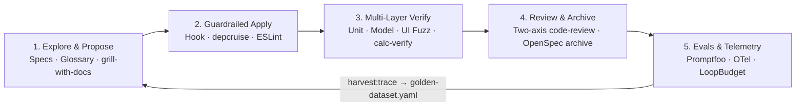

# Calculator App — An AI-Native Engineering Reference

[](https://github.com/ndsrf/CalculatorApp/actions/workflows/ci.yml)

A small, runnable reference repository that shows **how to structure a codebase so AI coding agents produce trustworthy work**. It is vendor-neutral: no assumptions about which agent, IDE, or model provider you use.

The product is deliberately boring: a Vite + TypeScript calculator with a **Standard Keypad** and an **Expression Input**. All the interesting parts sit _around_ the app. They cover context, guardrails, verification, evals, and feedback loops, and you can apply the same patterns to any codebase.

> **Everything runs locally and offline.** No Docker, no SaaS accounts, no API keys. Real models are optional.

---

## Why This Repo Exists

Coding agents are good at writing code. They tend to fail in other ways:

- They **guess** at your vocabulary, selectors, and conventions because nobody wrote them down.
- They **follow prose rules until it's inconvenient** ("don't use `eval`"), with nothing mechanical to stop them.
- They **can't see** what they built, so "done" means "it compiles".
- They **game the checks**, editing the test instead of the code when the test is red.
- Their **prompts and models change silently**, and nobody notices quality drifting.

Each folder in this repo exists to close one of those gaps. If you remember nothing else, remember these five ideas:

| #   | Idea                                     | In one sentence                                                                                      |
| --- | ---------------------------------------- | ---------------------------------------------------------------------------------------------------- |
| 1   | **One source of truth for context**      | Terms, features, selectors, and decisions live in small canonical docs that agents must read first.  |
| 2   | **Turn rules into gates**                | Every rule that matters is enforced by a linter, test, hook, or CI check, not just written in prose. |
| 3   | **Give agents eyes**                     | Agents verify their work through a CLI that drives the real UI and returns structured evidence.      |
| 4   | **Treat prompts like code**              | Prompts are versioned files with evals, binary safety gates, and cost/latency budgets.               |
| 5   | **Close the loop; humans own "correct"** | Failures become permanent regression tests, and humans approve any change to the checks themselves.  |

---

## Quick Start

**Prerequisites:** Node.js 22+ and npm.

```bash
npm install
npx playwright install chromium
npm run check        # runs every gate CI runs, in order
```

You should see every step pass: formatting, doc governance, architecture rules, dead-code scan, state-chart drift, build, 30+ tests (unit, model-based, browser contract, UI fuzzing, hook), and offline evals.

Then look at the app the way an agent does:

```bash
npm run dev                                   # terminal 1: http://localhost:5173
npm run verify:cli -- press 8 divide 0 equals --snapshot   # terminal 2
```

```json
{
  "status": "ok",
  "ui_state": {
    "display": "Cannot divide by zero",
    "expression_input": "",
    "error_state": true,
    "operators_disabled": true
  },
  "console_errors": []
}
```

### Learn by Breaking It (10 minutes)

The fastest way to understand the harness is to violate it and watch it catch you. Revert each change with `git checkout .` afterwards.

| Try this                                                                                   | Then run                                                              | What catches it                                          |
| ------------------------------------------------------------------------------------------ | --------------------------------------------------------------------- | -------------------------------------------------------- |
| Write "the screen shows 0" in `openspec/specs/keypad/spec.md`                              | `npm run lint:docs`                                                   | Banned glossary synonym (`screen` → **Primary Readout**) |
| Create `openspec/specs/history/spec.md`                                                    | `npm run lint:docs`                                                   | Spec folder not anchored 1:1 in `docs/feature-map.md`    |
| Add `return eval(input)` in `src/core/parser.ts`                                           | `npm run lint:arch`                                                   | ESLint rule that cites ADR 001                           |
| Add `import { mountCalculator } from '../ui/calculator-ui.ts'` to `src/core/calculator.ts` | `npm run lint:arch`                                                   | dependency-cruiser: core must stay pure                  |
| Change `data-op="add"` to `data-op="plus"` in `src/ui/calculator-ui.ts`                    | `npm run test:cli`                                                    | UI no longer matches the Feature Map contract            |
| Pretend to be an agent editing the verifier                                                | `.agents/hooks/pre-tool-guard.sh tools/calc-verify/index.ts; echo $?` | Pre-tool hook blocks with exit `2`                       |
| Make the stub leak `#display-current` in `evals/providers/deterministic-stub.mjs`          | `npm run eval`                                                        | Non-leakage safety assertion                             |

---

## The AI-Native Engineering Loop



---

## The Practices, Layer by Layer

Each layer exists because the one before it leaves a specific failure mode open.

| Layer | Practice                                       | Failure mode it prevents                                            | Enforced by                                     |
| ----- | ---------------------------------------------- | ------------------------------------------------------------------- | ----------------------------------------------- |
| 1     | Canonical context & 1:1 living specs           | Terminology drift, orphan specs, hallucinated selectors             | `npm run lint:docs`                             |
| 2     | Reusable agent skills & two-axis review        | Vague prompts → unexamined assumptions; reviews that miss spec gaps | Skills in `.agents/skills/`                     |
| 3     | Hard guardrails & architectural boundaries     | Agents ignoring prose rules; editing the tests to go green          | Hook, `lint:arch`, `lint:deadcode`, CODEOWNERS  |
| 4     | Verification pyramid & generated artifacts     | Happy-path-only tests, selector drift, stale diagrams               | `npm test`, state-chart drift check             |
| 5     | Versioned prompts, evals & tier routing        | Silent prompt regressions, prompt injection, overspending on models | `npm run eval`                                  |
| 6     | Telemetry, circuit breakers & trace harvesting | Runaway agent loops; the same production failure happening twice    | `trace:demo`, `harvest:trace`, `LoopBudget`     |
| 7     | Repository hygiene & diff protection           | Context-window pollution, noisy diffs, unreviewed harness changes   | Prettier, ignore files, CODEOWNERS, PR template |
| 8     | Production boundaries (outside the repo)       | Cramming orchestration and durable state into app code              | Architecture decision, not tooling              |

<details>
<summary><strong>Layer 1 — Canonical Context & 1:1 Living Specs</strong></summary>

- **Problem:** Agents drift on terminology (`screen` vs **Primary Readout**), spawn a new spec file per ticket, or invent DOM selectors.
- **How it works:** Every session starts from a small canonical truth set. It contains operating rules, a Feature Map anchoring each feature 1:1 to an in-place living spec and its exact DOM selectors, a Glossary with explicitly **banned synonyms**, `@persona:` tags, and ADRs for non-obvious decisions. A linter enforces 1:1 parity and vocabulary mechanically.
- **Files:** [`AGENTS.md`](AGENTS.md), [`docs/feature-map.md`](docs/feature-map.md), [`docs/glossary.md`](docs/glossary.md), [`docs/personas.md`](docs/personas.md), [`docs/adr/`](docs/adr/), [`openspec/specs/`](openspec/specs/), [`scripts/lint-docs.ts`](scripts/lint-docs.ts).
- **Why it matters:** A glossary only helps if it's enforced. Banning synonyms is cheap and removes a whole class of "the agent called it something else" bugs.

</details>

<details>
<summary><strong>Layer 2 — Reusable Agent Skills & Two-Axis Review</strong></summary>

- **Problem:** Going straight from a vague prompt to code bakes in unexamined assumptions. Single-pass reviews let clean-looking code hide missing requirements, or the reverse.
- **How it works:** Before coding, the `grill-with-docs` skill interviews the requester and writes the answers into the Glossary, ADRs, and spec deltas. After coding, the `code-review` skill runs two independent reviewers in parallel. One checks **Standards** (architecture, `AGENTS.md`, code smells) and the other checks **Spec** (`openspec/specs/`, Feature Map, edge cases). Keeping them separate stops one axis from masking the other.
- **Files:** [`.agents/skills/`](.agents/skills/) (vendored verbatim from [`mattpocock/skills`](https://github.com/mattpocock/skills), pinned by commit and hash in [`skills-lock.json`](skills-lock.json)). `AGENTS.md` maps the skills' upstream default paths onto this repo's paths, so the vendored files never need editing.

</details>

<details>
<summary><strong>Layer 3 — Hard Guardrails & Architectural Boundaries</strong></summary>

- **Problem:** Prose instructions are advisory. Under pressure, agents import DOM globals into pure logic, reach for `eval()`, leave dead helpers behind, or edit the test harness to make red checks turn green.
- **How it works:**
  - `dependency-cruiser` keeps `src/core/` pure and forces `src/ui/` to import only the core barrel.
  - ESLint bans `eval()`/`new Function()` **with an error message that points to ADR 001**, so the agent learns _why_ and _what to do instead_. It also blocks browser globals in `src/core/` and warns on restating comments.
  - `knip` flags unused files, exports, and dependencies (agents over-generate).
  - A portable **pre-tool hook** blocks edits to `tools/calc-verify/` unless a human sets `ALLOW_VERIFY_EDIT=1`, and blocks spec folders that aren't in the Feature Map. It exits `2` (the common "block" convention), accepts a path argument or an agent-hook JSON payload, normalises `../` tricks, and has its own tests.
- **Files:** [`.agents/hooks/pre-tool-guard.sh`](.agents/hooks/pre-tool-guard.sh), [`tests/pre-tool-guard.test.ts`](tests/pre-tool-guard.test.ts), [`.dependency-cruiser.cjs`](.dependency-cruiser.cjs), [`eslint.config.js`](eslint.config.js), [`knip.json`](knip.json).

</details>

<details>
<summary><strong>Layer 4 — Verification Pyramid & Auto-Generated Artifacts</strong></summary>

- **Problem:** Hand-picked happy-path tests miss state-machine corner cases, runtime crashes, selector drift, and stale diagrams.
- **How it works:** Four complementary layers:
  1. **Unit tests** for the parser and state machine.
  2. **Model-based tests** (`fast-check`): 200 random command sequences checked against invariants (never `NaN`/`Infinity`, `AC` always recovers).
  3. **Browser fuzzing** (Playwright + `fast-check`): random clicks and malformed input against the real app, asserting zero console/page errors.
  4. **`calc-verify`**, an agent-facing verification CLI. It speaks only Feature Map names, uses a fresh browser context per run (idempotent), and returns JSON snapshots, PNG screenshots, and Playwright trace ZIPs. A **contract test** fails if the CLI and `docs/feature-map.md` disagree.

  `docs/state-chart.md` is generated from `CALCULATOR_STATE_TRANSITIONS` in code, and CI fails if it drifts.

- **Files:** [`src/core/*.test.ts`](src/core/), [`tests/ui-fuzz.test.ts`](tests/ui-fuzz.test.ts), [`tools/calc-verify/`](tools/calc-verify/), [`scripts/generate-state-chart.ts`](scripts/generate-state-chart.ts).

</details>

<details>
<summary><strong>Layer 5 — Versioned Prompts, Evals & Tier-Based Model Routing</strong></summary>

- **Problem:** Unversioned prompts regress silently, agents leak internals under prompt injection, and sending every task to the biggest model wastes latency and money.
- **How it works:**
  - Prompts are Markdown files with frontmatter: `id`, `version`, and `model_routing.tier` (`frontier` or `lightweight`) plus a written rationale. **Prompts never name a vendor model.** Tiers are mapped to concrete models through `EVAL_PROVIDER_<TIER>` environment variables, so switching providers is a config change validated by the same evals.
  - The eval runner strips the frontmatter (so routing metadata never reaches the model), builds one Promptfoo provider per prompt from its tier, and runs each route separately.
  - Assertions include exact CLI-format checks, non-leakage checks (`#display-current`, `data-op`, …), **binary safety gates** (`threshold: 1`) for code injection and prompt injection, and cost (`<= $0.01`) and latency (`<= 5s`) budgets. With real models configured, `llm-rubric` assertions add an LLM-as-judge.
  - With no provider configured, evals run against an offline **deterministic stub** so CI never needs a key and the eval _plumbing_ is always tested.
- **Files:** [`prompts/`](prompts/), [`evals/promptfooconfig.yaml`](evals/promptfooconfig.yaml), [`evals/golden-dataset.yaml`](evals/golden-dataset.yaml), [`evals/providers/deterministic-stub.mjs`](evals/providers/deterministic-stub.mjs), [`scripts/run-eval.ts`](scripts/run-eval.ts), [`.env.example`](.env.example).

</details>

<details>
<summary><strong>Layer 6 — Telemetry, Circuit Breakers & Trace Harvesting</strong></summary>

- **Problem:** Passing offline evals doesn't stop a runaway tool-call loop in a live run, and it doesn't stop yesterday's production failure from happening again.
- **How it works:** Traced runs emit OpenTelemetry spans with `gen_ai.*` usage, the SHA-256 of the prompt file (`prompt.sha`, so every run is tied to an exact prompt version), and **business outcomes** (`outcome.status`, `outcome.leaked_selector`, `outcome.tool_calls_count`, …) to `traces/runs.jsonl` or any OTLP collector. `LoopBudget` is a hard circuit breaker (`maxToolCalls`, `maxTokens`). When a run fails, `harvest:trace` turns that span into a permanent regression case in the golden dataset. The operation is idempotent and records provenance.
- **Files:** [`src/observability/`](src/observability/), [`scripts/run-traced-demo.ts`](scripts/run-traced-demo.ts), [`scripts/harvest-trace.ts`](scripts/harvest-trace.ts), [`traces/sample-failed-trace.jsonl`](traces/sample-failed-trace.jsonl).

</details>

<details>
<summary><strong>Layer 7 — Repository Hygiene & Diff Protection</strong></summary>

- **Problem:** Logs and archived specs pollute agent context, reformatting churn bloats diffs, and agents can bypass local hooks entirely in remote branches.
- **How it works:**
  - **Context exclusion:** [`.cursorignore`](.cursorignore) is the reference list of paths agents shouldn't read. See [`docs/agent-adapters.md`](docs/agent-adapters.md) to mirror it in your tool.
  - **CODEOWNERS:** human approval is required for changes to anything that defines "correct", including agent rules, prompts, the verifier, evals, scripts, lint configs, and CI. _It is only enforced once branch protection turns on "Require review from Code Owners"._
  - **PR template:** evidence-based handoff, with Feature Map links, spec deltas, `calc-verify` snapshots, and an **AI Assistance** section stating what an agent generated and what a human verified.
  - **CI least privilege:** `permissions: contents: read`, plus failure evidence (traces, screenshots) uploaded as artifacts.
  - **Prettier:** deterministic formatting, so diffs show only real changes.
- **Files:** [`.github/`](.github/), [`.prettierrc`](.prettierrc), [`.cursorignore`](.cursorignore).

</details>

<details>
<summary><strong>Layer 8 — Production Boundaries (Deliberately Outside the Repo)</strong></summary>

Three concerns belong outside the application source:

- **Concurrency & isolation:** run parallel agents in the orchestration layer (git worktrees, ephemeral sandboxes, agent fleet tooling), not with ad-hoc locks in app code.
- **Durable execution:** long-running, multi-step flows with retries or human approvals belong in a workflow engine (e.g. Temporal, Restate), not in an LLM conversation history.
- **Outcome metrics:** measure revert rate, review cycle time, and escaped defects, not PR count or lines generated.

</details>

---

## Walkthrough: Adding a Feature End-to-End (Square Root `√` / `sqrt`)

Suppose we add **Square Root**: a `√` key on the **Standard Keypad** for `@persona:casual-user` and `sqrt(...)` in the **Expression Input** for `@persona:power-user`. [ADR 001](docs/adr/001-expression-parser.md) already anticipates this.

> Uncommented commands run against the repo today. Commented commands show checks you'd add once the feature exists.
> The `/opsx:*` commands come from the optional [OpenSpec](https://github.com/Fission-AI/OpenSpec) tooling. The folder conventions work fine without it.

**1. Explore** _(developer + agent)_ — Read the files listed in [`AGENTS.md`](AGENTS.md) §1. Square Root extends three existing Feature Map sections (`keypad`, `expression-input`, `error-handling`), so specs are **updated in place**, with no new spec folder. The output is an impact map and no code yet.

**2. Propose** _(developer + agent, e.g. `/opsx:propose add-square-root`)_ — Create `openspec/changes/add-square-root/` with:

- `proposal.md` (problem, persona stories, non-goals)
- `design.md` (grammar rule for `sqrt(<expr>)`, `pressSquareRoot` transition, selector `[data-action="sqrt"]`)
- `specs/` (deltas to the 3 existing specs)
- `tasks.md` (ordered checklist)

**3. Grill the proposal** _(the `grill-with-docs` skill)_ — Stress-test it before coding:

- _`sqrt(-9)` or `√` on a negative value?_ → **Error State** with a deterministic message, never `NaN`, and recovery only via **All Clear (AC)**.
- _`5 + 9 √ =`?_ → `√` applies to the active entry only (`5 + 3 = 8`).
- _`sqrt(sqrt(16))`?_ → Works if `sqrt` parses as a primary expression.
- Glossary gains **Square Root (√)** (banning `radical button`), the Feature Map gains `[data-action="sqrt"]`, and `docs/adr/002-unary-math-functions.md` is added if the trade-off is reusable.

```bash
npm run lint:docs
.agents/hooks/pre-tool-guard.sh openspec/specs/unmapped-feature/spec.md   # exit 2: orphan spec folder
.agents/hooks/pre-tool-guard.sh openspec/specs/keypad/spec.md             # exit 0: mapped spec
```

**4. Apply inside the guardrails** _(e.g. `/opsx:apply add-square-root`)_:

1. Pure logic in `src/core/` (`parser.ts`, `calculator.ts`, `index.ts` barrel).
2. Thin UI: `<button type="button" data-action="sqrt">√</button>` in `src/ui/calculator-ui.ts`.
3. Unit tests, a `SquareRootCommand` in the model test, then `npm run docs:state-chart`.
4. The contract test now fails until `calc-verify` learns `sqrt`. **That edit is protected**: a human must authorize it (`ALLOW_VERIFY_EDIT=1` locally, CODEOWNERS approval on the PR).

```bash
.agents/hooks/pre-tool-guard.sh tools/calc-verify/index.ts                     # exit 2 (blocked)
ALLOW_VERIFY_EDIT=1 .agents/hooks/pre-tool-guard.sh tools/calc-verify/index.ts # exit 0 (authorized)
npm run lint:arch && npm run lint:deadcode && npm run build
```

**5. Verify and capture evidence**:

```bash
npm test                                   # unit + model + contract + browser fuzz + hook tests
npm run dev                                # then, in another terminal:
npm run verify:cli -- press 8 divide 0 equals --snapshot --screenshot traces/div-zero.png --trace traces/div-zero.zip
npm run verify:cli -- type-expression "(10 + 5) * 2 - 4 / 2" --submit --snapshot
# npm run verify:cli -- press 9 sqrt --snapshot --screenshot traces/sqrt-9.png
# npm run verify:cli -- type-expression "sqrt(16) + 2" --submit --snapshot
```

Attach the JSON snapshot (and screenshot/trace for UI changes) to the PR.

**6. Review and archive** — Run the `code-review` skill against `main` to get separate **Standards** and **Spec** reports. An example Spec finding: "forgot to lock `√` in Error State". Then archive with `/opsx:archive add-square-root`, which merges the deltas into the living specs and moves the change folder to `openspec/changes/archive/` (excluded from agent context). Finish with `npm run check`.

**7. Evals, tracing and closing the loop** — If the feature touches agent behavior, update `prompts/calc-tester-agent.md` (bump its `version`) and add a case to `evals/golden-dataset.yaml`.

```bash
npm run eval                                 # offline stub; see .env.example to run real models
npm run trace:demo && cat traces/runs.jsonl  # emit a real OTel span
npm run harvest:trace -- --trace-id sample-fail-001 --file traces/sample-failed-trace.jsonl --dry-run
npm run harvest:trace -- --trace-id sample-fail-001 --file traces/sample-failed-trace.jsonl
npm run eval                                 # the harvested regression now runs on every PR
git checkout -- evals/golden-dataset.yaml    # undo the sample harvest
```

---

## Who Runs What: Developer vs. CI

| Stage / Check                                                 | Developer |   CI   | Gate                                                                       |
| ------------------------------------------------------------- | :-------: | :----: | -------------------------------------------------------------------------- |
| OpenSpec explore → propose → grill → apply → review → archive |    ✅     |   —    | Approved proposal, updated living specs, two-axis review report            |
| Pre-tool hook                                                 |    ✅     |   —    | Blocks harness edits and orphan spec folders during agent sessions         |
| `verify:cli` snapshots / screenshots / traces                 |    ✅     |   —    | Evidence attached to the PR                                                |
| `trace:demo`, `harvest:trace`                                 |    ✅     |   —    | New regression cases in the golden dataset                                 |
| `npm run check` (all rows below)                              |    ✅     |   ✅   | Single command, identical to CI                                            |
| `format:check`                                                |    ✅     |   ✅   | Formatting drift                                                           |
| `lint:docs`                                                   |    ✅     |   ✅   | Banned synonyms, unknown personas, broken 1:1 spec parity                  |
| `lint:arch`, `lint:deadcode`                                  |    ✅     |   ✅   | Boundary violations, `eval`, DOM globals in core, dead code                |
| State-chart drift                                             |    ✅     |   ✅   | `docs/state-chart.md` out of sync with code                                |
| `build`, `test:unit`, `test:model`, `test:cli`, `test:fuzz`   |    ✅     |   ✅   | Types, logic, invariants, Feature Map contract, runtime errors, hook logic |
| `eval`                                                        |    ✅     |   ✅   | Output format, selector leaks, binary safety, cost/latency, rubric (live)  |
| CODEOWNERS + PR template                                      |  Review   | GitHub | Human approval on rules, harness, evals, gates                             |

<details>
<summary><strong>Full command reference</strong></summary>

| Command                        | What it runs                                                                         |
| ------------------------------ | ------------------------------------------------------------------------------------ |
| `npm run check`                | Every CI gate, in CI order.                                                          |
| `npm run dev` / `build`        | Vite dev server (`:5173`) / typecheck + production bundle.                           |
| `npm run format[:check]`       | Prettier write / check.                                                              |
| `npm run lint:docs`            | Glossary, persona, and Feature Map ↔ spec parity checks.                             |
| `npm run lint:arch`            | dependency-cruiser + ESLint architecture rules.                                      |
| `npm run lint:deadcode`        | knip unused files/exports/dependencies.                                              |
| `npm run docs:state-chart`     | Regenerate `docs/state-chart.md` from code.                                          |
| `npm test`                     | All Vitest suites.                                                                   |
| `npm run test:unit`            | Parser, state machine, `LoopBudget`, and pre-tool hook tests.                        |
| `npm run test:model`           | `fast-check` model-based state-machine tests.                                        |
| `npm run test:cli`             | `calc-verify` Feature Map contract + Playwright integration tests.                   |
| `npm run test:fuzz`            | Playwright + `fast-check` browser fuzzing.                                           |
| `npm run verify:cli -- ...`    | Drive the running app by Feature Map names.                                          |
| `npm run eval[:deterministic]` | Promptfoo evals (live if `EVAL_PROVIDER_*` is set; `:deterministic` forces offline). |
| `npm run trace:demo`           | Traced `calc-verify` run → `traces/runs.jsonl` (or OTLP).                            |
| `npm run harvest:trace -- ...` | Failing span → regression case in `evals/golden-dataset.yaml`.                       |

</details>

---

## Using It With Your Agent and Model

Nothing here is tied to a vendor:

- **Rules** live in [`AGENTS.md`](AGENTS.md), an open cross-tool convention. Tools that read a different file get a one-line pointer, never a copy.
- **Skills** are plain `SKILL.md` folders under `.agents/skills/`.
- **The hook** is a Bash script with a simple contract (path or JSON in; exit `0`/`2` out).
- **Models** are chosen by _tier_ in prompt frontmatter and mapped to any provider through environment variables. Local models work too.
- **The most important gates** (lint, tests, evals, CI, CODEOWNERS) don't depend on the agent at all.

See [`docs/agent-adapters.md`](docs/agent-adapters.md) for wiring instructions.

---

## Adopting These Practices in Your Own Repo

You don't need all eight layers on day one. A pragmatic order, with highest return first:

1. **`AGENTS.md` with commands and a definition of done**, plus **CI that runs the same single command** (`npm run check`). This is the biggest win for the least effort.
2. **Turn your top 3 recurring review comments into lint rules**, with error messages that explain the fix (see the `eval` rule citing ADR 001).
3. **A glossary with banned synonyms** and a small doc linter. Add **ADRs** for decisions agents keep re-litigating.
4. **CODEOWNERS on the harness** (tests infra, evals, lint config, CI, `AGENTS.md`) with branch protection on.
5. **An agent-runnable verification command** that returns structured evidence (JSON + screenshot), plus a contract test that keeps it honest.
6. **Property/model-based tests** for any stateful core logic.
7. If you ship LLM features: **prompts as versioned files, tiered routing, an offline eval stub, and binary safety gates**.
8. Then **telemetry and trace harvesting**, once you have real traffic worth learning from.

**Don't copy blindly:** the 1:1 Feature Map ↔ spec rule and the DOM-selector contract suit UI-centric products. A backend service might anchor specs to API endpoints or domain modules instead. Keep the _principle_ (one canonical map, mechanically enforced) and change the shape.

---

## Honest Limits

A reference repo should be clear about what it _doesn't_ prove:

- **The pre-tool hook is a speed bump, not a wall.** It only sees file-edit tool calls, so an agent with shell access can bypass it. Server-side controls (CODEOWNERS + branch protection + CI) are the real enforcement.
- **Offline evals test the plumbing, not the model.** The deterministic stub proves that assertions, routing, and harvesting work. Only live runs (`EVAL_PROVIDER_*`) say anything about model quality, and `llm-rubric` judges are themselves non-deterministic.
- **`src/observability/` is Node-only harness code** that lives under `src/` for import convenience. dependency-cruiser stops the browser UI from importing it. In a larger system it would be its own package.
- **Model-based testing is not formal verification.** `fast-check` explores many random paths, not all of them. For distributed or concurrent designs, consider a model checker such as TLA+ at design time.
- **Context-exclusion files are tool-specific.** There is no universal standard yet (see the adapters guide).

---

<details>
<summary><strong>Jargon decoder</strong></summary>

| Term                            | Meaning here                                                                                          |
| ------------------------------- | ----------------------------------------------------------------------------------------------------- |
| **Context engineering**         | Deciding what an agent reads before it acts, and keeping that material small, canonical, and current. |
| **Living spec**                 | A spec updated in place as behavior changes, unlike a per-ticket document that goes stale.            |
| **Skill**                       | A reusable, named workflow (a `SKILL.md`) that an agent can load on demand.                           |
| **Hook**                        | A script the agent host runs before/after a tool call, which can block the action.                    |
| **Eval / golden dataset**       | Tests for LLM outputs, and the curated set of input cases they run against.                           |
| **LLM-as-judge (`llm-rubric`)** | Using a model to grade another model's output against a written rubric.                               |
| **Binary safety gate**          | An eval case that must pass 100% (`threshold: 1`). No partial credit.                                 |
| **Tier-based model routing**    | Prompts declare the capability they need; configuration chooses the actual model.                     |
| **Circuit breaker**             | A hard limit (tool calls, tokens) that stops a looping agent run.                                     |
| **Trace harvesting**            | Turning a failed production trace into a permanent regression test.                                   |
| **Model-based testing**         | Random command sequences run against the real system and a simple model, checking that they agree.    |

</details>

<details>
<summary><strong>Repository map</strong></summary>

| Path                                                         | Role                                                                                         |
| ------------------------------------------------------------ | -------------------------------------------------------------------------------------------- |
| `AGENTS.md`                                                  | Agent operating rules: required reading, commands, definition of done, guardrails.           |
| `.agents/skills/` & `skills-lock.json`                       | Vendored, pinned skills: `grill-with-docs` (+ `grilling`, `domain-modeling`), `code-review`. |
| `.agents/hooks/pre-tool-guard.sh`                            | Portable pre-edit guardrail hook.                                                            |
| `docs/feature-map.md`                                        | Features ↔ specs ↔ DOM selectors (single source of truth).                                   |
| `docs/glossary.md` · `docs/personas.md`                      | Canonical terms + banned synonyms · supported `@persona:` tags.                              |
| `docs/adr/`                                                  | Architecture decision records.                                                               |
| `docs/state-chart.md`                                        | Generated Mermaid state diagram (do not edit by hand).                                       |
| `docs/agent-adapters.md`                                     | How to wire the neutral artifacts into specific agent tools.                                 |
| `openspec/`                                                  | Living specs (`specs/`), in-flight changes (`changes/`), and their archive.                  |
| `src/core/`                                                  | Pure parser + state machine, with unit and model-based tests.                                |
| `src/ui/`                                                    | Thin DOM layer bound to Feature Map selectors.                                               |
| `src/observability/`                                         | OpenTelemetry tracer and `LoopBudget` circuit breaker (Node-only).                           |
| `tools/calc-verify/`                                         | Agent verification CLI, broken fixture, contract and integration tests (protected).          |
| `tests/`                                                     | Browser fuzzing and pre-tool hook tests.                                                     |
| `prompts/`                                                   | Versioned agent prompts with tier-based routing frontmatter.                                 |
| `evals/`                                                     | Promptfoo config, golden dataset, offline stub provider.                                     |
| `traces/`                                                    | Local trace output (gitignored) + a committed sample failing trace.                          |
| `scripts/`                                                   | Doc lint, state-chart generator, eval runner, trace demo, trace harvester.                   |
| `.dependency-cruiser.cjs` · `eslint.config.js` · `knip.json` | Architecture, lint, and dead-code gates.                                                     |
| `.github/`                                                   | CI workflow, CODEOWNERS, PR template.                                                        |

</details>
